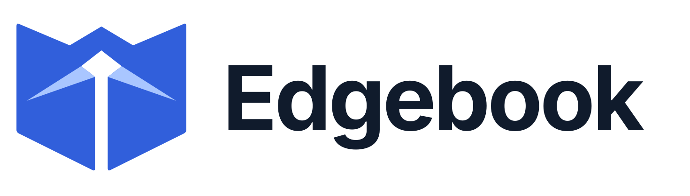
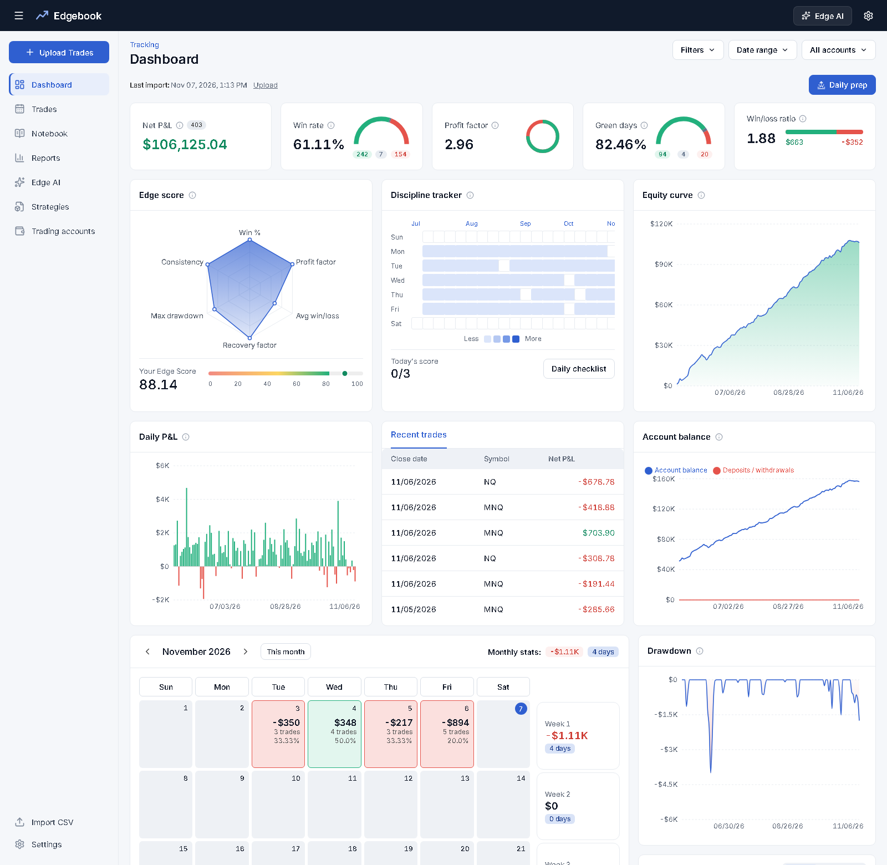
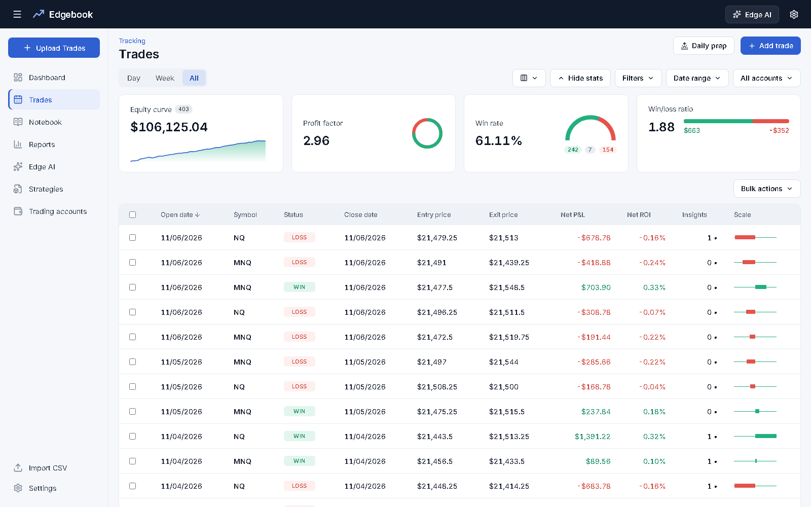
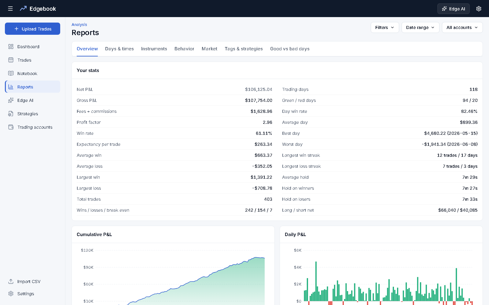

<p align="center">
  <picture>
    <source media="(prefers-color-scheme: dark)" srcset="docs/logo-dark.svg">
    
  </picture>
</p>

<p align="center"><strong>The trading journal that tells you why.</strong></p>

<p align="center">
Track every trade, journal every session, and get an AI review that reads your fills, your notes, your charts and the market together.
</p>

<p align="center">
<a href="#get-started"><strong>Get started</strong></a> ·
<a href="#features">Features</a> ·
<a href="#what-it-costs">What it costs</a> ·
<a href="#faq">FAQ</a>
</p>



<p align="center"><sub>Screenshots use made-up sample trades, not real results.</sub></p>

## Your stats tell you what happened. Edgebook tells you why.

Most trading journals read your own numbers back to you. Edgebook does that too, with a full dashboard, calendar and reports. Then **Edge AI** goes further: it compares what you wrote with what you did, reads your chart screenshots against real price action, and finds what your best and worst days have in common.

It runs on your own server, with no subscription to Edgebook and no limit on accounts.

## Features

### Upload and go
- **One-step imports.** Drop in your Topstep or Tradovate exports, as many files as you like at once.
- **Lucid support.** Lucid accounts on Tradovate work too. Tradovate files identify their own account, so they land in the right place.
- **Fees that add up.** Commissions come from your Tradovate Cash History, and each upload is checked against what Tradovate actually booked.
- **Automatic R-multiples.** Tradovate stop orders fill in your planned risk with no typing.
- **No duplicates.** Upload the same file twice and nothing changes. Any import can be undone.

### Built for copy traders
- **Unlimited accounts.** Add as many as you run.
- **One trade, not five.** When several accounts take the same trade, Edgebook recognizes it automatically and shows one trade with the combined size and P&L, so your win rate stays honest and your dollars stay complete.
- **Zero setup.** There's no lead account to pick. A trade only one account took stays its own trade.

### See your whole trading picture
- **Dashboard.** Net P&L, win rate, profit factor, green days, equity curve, drawdown and account balance.
- **Edge Score.** One 0–100 score blending win rate, profit factor, win/loss ratio, recovery, drawdown and consistency.
- **P&L calendar.** Every day and week at a glance. Click any day for the full story.
- **Reports.** Break results down by time of day, instrument, direction, hold time, market conditions, setups, mistakes and more.



### Journal the way you trade
- **Day pages.** Paste your chart and execution screenshots with Ctrl+V, write your notes, log your mood and tick your checklist.
- **Price charts.** Recent trades are marked on real candles, with how far price moved for and against you.
- **A real notebook.** Folders, search, checkboxes, colors, highlights, divider lines, images and links.
- **Your own templates.** Save any note as a template, or build a library of pre-market plans and recaps.
- **Trade review.** Tag setups and mistakes, rate your execution, and assign strategies.

### Edge AI
- **Daily debriefs.** What really happened, judged against the market, with a process grade separate from your P&L.
- **Weekly and monthly reviews.** The pattern that defined the period and the one change that matters most.
- **Edge and pattern reports.** Your higher- and lower-probability conditions, ranked across your full history.
- **Custom analysis.** Write any prompt, pick a date range and get a full report on it.
- **Ask your journal.** Chat with an AI that can see your trades, your recent notes and your past reports.
- **Rules that stick.** Adopt a suggested rule, and later reports check whether you followed it.
- **No repeat reports.** Edge AI reads its earlier reports and is told to build on them, not repeat them.



## Get started

Everyone runs their own private copy, which takes about 10 minutes.

**You'll need:** a GitHub account, a [Railway](https://railway.com) account, and a [Claude API key](https://console.anthropic.com) if you want Edge AI.

1. **Fork this repository** to your GitHub account.
2. **Deploy it.** In Railway, choose **New Project**, then **Deploy from GitHub repo**, and pick your fork. Railway finds everything it needs.
3. **Set your password.** Open the service's **Variables** and add `EDGEBOOK_PASSWORD` with a long password of your own. The app won't start without it.
4. **Add a volume.** Right-click an empty part of the project canvas, or press Ctrl+K, and create a volume on your service with the mount path `/data`.

   > **Don't skip this.** The volume is what keeps your journal. Without it, every update wipes your data.

5. **Get your address.** Under **Settings > Networking**, choose **Generate Domain**. If it asks for a port, use the one in your Deploy Logs, on the line starting `Edgebook is running on`.
6. **Sign in and pin the tab.** You stay signed in for 180 days on that browser.
7. **Finish setup.** In the app's Settings, add your Claude API key, your break-even range and your time zone.

Before you upload your full history, confirm your data is safe: upload one file, redeploy in Railway, and check that your trades are still there.

### Your daily routine

1. Export your trades and drop them into **Upload Trades**.
   - **Topstep:** the trades export. Pick an account for each file, because Topstep files don't say which account they came from.
   - **Tradovate or Lucid:** in Account Reports, download **Orders** and **Cash History** for the same dates.
2. Open the day and paste in your charts.
3. Write your notes, log your mood and tick your checklist.
4. Click **Debrief this day**.

## What it costs

Edgebook has no subscription of its own. You pay your providers directly:

| | What you pay |
|---|---|
| **Hosting** | Your Railway plan. See [Railway pricing](https://docs.railway.com/reference/pricing). |
| **Edge AI** | Claude API usage, billed separately from a Claude subscription. Every report shows what it cost, and you can pick a cheaper model in Settings. |
| **Everything else** | Nothing. Edge AI is optional, and the journal, reports and pattern tools work without it. |

## Your data stays yours

- **Your own server.** Trades, notes, screenshots and your API key live on your own volume, never in this repository.
- **Password protected.** Nothing is readable without signing in.
- **AI only when you ask.** Your data goes to the Claude API only when you run a report or ask a question.
- **Daily backups.** The app keeps 14 days of database backups on your volume. Use **Settings > Download backup** to keep your own copy too. That file doesn't include screenshots.

## FAQ

**Which brokers and prop firms work?**
Edgebook imports Topstep's trade export and Tradovate's Orders and Cash History reports, which covers Lucid accounts on Tradovate. Other platforms can be added by hand, one trade at a time.

**Can I share one copy with friends?**
Each person should run their own. A copy is built for one trader, so everyone signed in to it shares the same journal, password and AI key.

**Why don't older days have price charts?**
Market data comes from Yahoo's free feed, which keeps 1-minute bars for about a month and 5-minute bars for about two months. Upload regularly and each day's bars are saved for good. Older days rely on your notes and screenshots. The feed is unofficial, so it can change without notice.

**What counts as the same trade across accounts?**
Same market, same direction, same day, with the entry and exit each within 10 seconds of each other at nearly the same price. NQ and MNQ can match. If you'd rather count each account separately, there's a setting for that. To see one account's own trades, pick it in the account filter.

**Will Edge AI tell me what to trade?**
No. It reviews what has already happened and doesn't forecast markets. Edgebook is a journaling tool, not financial advice.

**How do I change my password?**
Update `EDGEBOOK_PASSWORD` on Railway. This signs out every device.

## Run it locally

To try it on Windows without hosting, double-click **Edgebook.bat**. It runs at http://localhost:4310 with no password and keeps its data in a local `data` folder.

For development:

```bash
npm run dev
```

```bash
npm test
```

Built with React, TypeScript, Express, SQLite and Claude.
